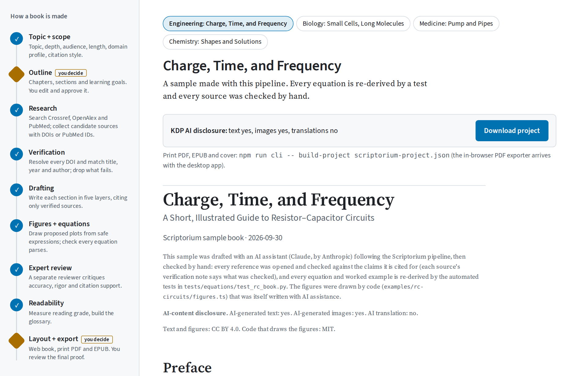
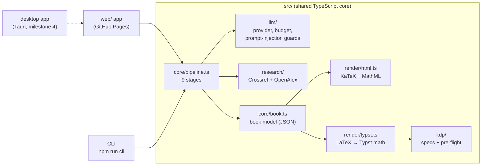
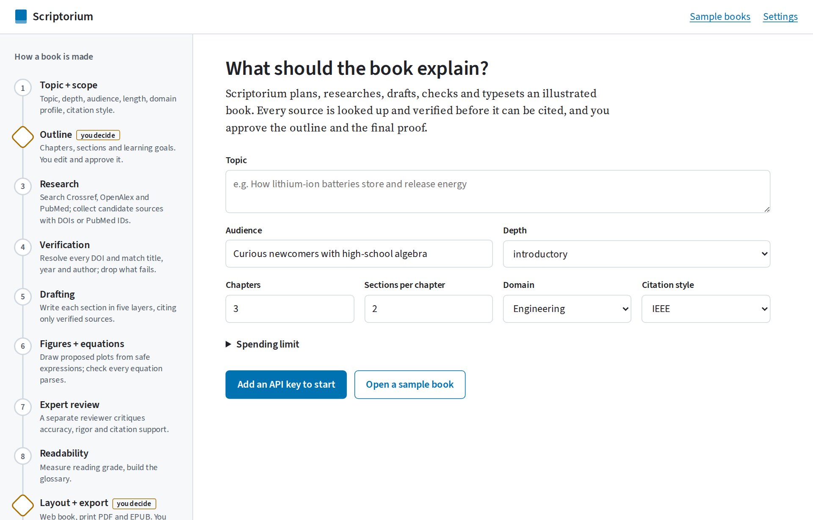
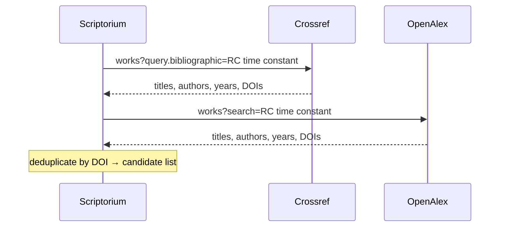

<!-- Hero: animated SVG (plays on GitHub; shows the final frame when motion is reduced) -->
<p align="center">
  <picture>
    <source media="(prefers-color-scheme: dark)" srcset="assets/rendered/hero.dark.svg">
    
  </picture>
</p>

<h1 align="center">Scriptorium</h1>

<p align="center"><b>Turn a topic into an illustrated, fully referenced book — checked like a journal paper, written like a good teacher — and export it for the web and for Amazon Kindle Direct Publishing (KDP).</b></p>

<p align="center">
  <a href="https://github.com/Normansrule/scriptorium/actions/workflows/ci.yml"></a>
  <a href="https://github.com/Normansrule/scriptorium/actions/workflows/codeql.yml"></a>
  <a href="LICENSE"></a>
  <a href="https://normansrule.github.io/scriptorium/"></a>
</p>

*Figure 1 — From a typed topic to a finished book in four visible steps; you approve the outline and the final proof.*

## Contents

1. [What you'll see](#what-youll-see)
2. [Quick start](#quick-start)
3. [How it works](#how-it-works)
4. [Walkthrough](#walkthrough)
5. [Project layout](#project-layout)
6. [Security](#security)
7. [Troubleshooting](#troubleshooting)
8. [References and further learning](#references-and-further-learning)
9. [Contributing, license and credits](#contributing-license-and-credits)

**Status:** milestone 1 of 4 is done — engineering profile, a three-chapter sample book, web export and print PDF with KDP pre-flight. See [Roadmap](#roadmap).

---

## What you'll see

<p align="center">
  
</p>

*Figure 2 — The app: the pipeline on the left (diamonds mark the two points where you decide), the book proof on the right.*

<p align="center">
  
</p>

*Figure 3 — A spread from the 6" × 9" print PDF. Each equation comes with an intuition sentence, a symbol table with units, a worked example that is re-checked by a test, and the conditions where it stops being valid.*

---

## Quick start

You need **Node.js 20.19 or newer** (22 recommended; `.nvmrc` pins 22) and **Python 3.10+** for the equation checks. On Windows, use WSL 2 or Git Bash for these commands; `scripts/setup.ps1` does the same setup in PowerShell.

```bash
git clone https://github.com/Normansrule/scriptorium.git
cd scriptorium
npm ci
npm run demo
```

Expected output of `npm run demo` (about 2 seconds):

```text
✓ Drew 18 figure files (light + dark)
✓ Web book  → dist/rc-circuits/web/index.html
✓ Print PDF → dist/rc-circuits/book.pdf (27 pages, 6" × 9")
✓ KDP pre-flight: 9/9 checks pass
✓ AI disclosure → dist/rc-circuits/ai-disclosure.json (text: yes, images: yes, translations: no)
Done in 1.3 s
```

Open `dist/rc-circuits/web/index.html` in a browser and `dist/rc-circuits/book.pdf` in a PDF viewer.

Run the checks:

```bash
npm test                                   # 54 unit, export and pipeline tests
python -m pip install -r requirements.txt
npm run test:equations                     # re-derives every equation in the sample book
```

Expected: `Tests  54 passed (54)` and `16 passed`.

Open the app (the same one that runs on GitHub Pages):

```bash
npm run app            # then open the address it prints, usually http://localhost:5173
```

One-step setup instead: `bash scripts/setup.sh` (Linux, macOS, WSL) or `pwsh scripts/setup.ps1` (Windows), or open the folder in a devcontainer (`.devcontainer/`).

---

## How it works

<p align="center">
  <picture>
    <source media="(prefers-color-scheme: dark)" srcset="assets/rendered/pipeline.dark.svg">
    
  </picture>
</p>

*Figure 4 — The nine stages. The two amber stages are human checkpoints: nothing is researched until you approve the outline, and nothing is published until you approve the proof.*

The architecture is one TypeScript core used by three front ends:



*Figure 5 — Architecture: the web app, the command line and (later) the desktop app share one core, so a book behaves the same everywhere.*

### 1 · Topic + scope

You give a topic, audience, depth, length, domain profile and citation style, plus a **spending cap** in tokens. The run stops *before* any model call that could exceed the cap:

$$ \text{spent} + \text{max\_tokens}(\text{next call}) \le \text{cap} \tag{1} $$

- *spent*: input + output tokens already used by this book, as reported by the provider (tokens)
- *max\_tokens*: the most the next reply may use (tokens)
- *cap*: your limit for this book (tokens)

Worked example: cap 400 000, spent 396 500, the next draft allows 6 000 → 402 500 > 400 000, so the run stops and asks you to raise the cap. Tested in `tests/unit/budget.test.ts`. The cap is in tokens rather than dollars because token counts come back exactly while prices change.



*Figure 6 — Stage 1 in the app.*

### 2 · Outline — checkpoint

The model proposes chapters, sections, learning goals and search queries as JSON. You edit and approve; nothing else happens until you do.

### 3 · Research

Search queries from the outline go to **Crossref** and **OpenAlex** (public scholarly databases). Only whitelisted fields are copied from their replies.



*Figure 7 — Research sends keywords only; no key, drafts or personal data.*

### 4 · Verification

A reference is kept only if its Digital Object Identifier (DOI) resolves in Crossref **and** the record matches. The title match uses the Jaccard similarity of the two titles' word sets:

$$ J(A,B) = \frac{\lvert A \cap B \rvert}{\lvert A \cup B \rvert} \ge 0.8 \tag{2} $$

- *A, B*: sets of lower-cased content words in the two titles (small words such as "the" and "of" removed); *J* has no unit and runs from 0 to 1.

Worked example: "A Practical Method of Designing RC Active Filters" vs. Crossref's "A practical method of designing RC active filters" → the same 6 content words → J = 6/6 = 1, and the year (1955) and first author (Sallen) also match, so the reference is verified. A fabricated title on a real DOI scores 0 and is dropped. Tested in `tests/unit/scholarly.test.ts`.

**Limits:** this proves the source *exists and is the one named*. Whether it *supports a claim* is checked in stage 7 against the abstract, and flagged for a human when it can't be confirmed.

### 5 · Drafting

Each section is written in five layers, so a reader can stop after any layer and still have a correct picture:

<picture>
  <source media="(prefers-color-scheme: dark)" srcset="assets/rendered/layers.dark.svg">
  
</picture>

*Figure 8 — The five writing layers, with examples from the sample book.*

The model may cite **only** references that passed stage 4, as `[@id]`. A citation guard removes anything else and records it in the verification report, so a model cannot invent a source into the book.


*Figure 9 — Before and after: drafting returns structured data; layout turns it into a finished page.*

### 6 · Figures + equations

Technical figures are **drawn by code**, never by an image generator. The model may propose a plot as an expression such as `1 - exp(-x)`; a small parser (`src/core/expr.ts`) evaluates it without `eval`, so a hostile expression can only fail to parse. Every equation must render in KaTeX and convert to Typst, or it is dropped.

<picture>
  <source media="(prefers-color-scheme: dark)" srcset="examples/rc-circuits/figures/tau.dark.svg">
  
</picture>

*Figure 10 — A code-drawn figure from the sample book: what changes when R changes. Drawn by `examples/rc-circuits/figures.ts`.*

In the sample book every equation's worked example is re-derived by SymPy (algebra) and Pint (units) in `tests/equations/test_rc_book.py`; for new books, equations are marked **unverified** in the report until you add such a check.

### 7 · Expert review

A second model call, with a separate "skeptical referee" prompt that never sees the drafting instructions, checks accuracy, the algebra and units of worked examples, missing caveats, and whether each citation is supported by that source's abstract. Its findings go into the verification report; high-severity ones are marked as problems.

### 8 · Readability

Body text targets reading grade 10–12, measured with the Flesch–Kincaid grade level [5]:

$$ G = 0.39\,\frac{\text{words}}{\text{sentences}} + 11.8\,\frac{\text{syllables}}{\text{words}} - 15.59 \tag{3} $$

- *G*: approximate U.S. school grade (no unit); *words, sentences, syllables*: counts in the text (math, citations and code removed first).

Worked example: "The cat sat on the mat." has 6 words, 1 sentence, 6 syllables → G = 0.39·6 + 11.8·1 − 15.59 = −1.45. Tested in `tests/unit/readability.test.ts`. **Limits:** syllables are counted with a vowel-group heuristic, so the grade is a guide for the readability pass, not a gate. The glossary is built from the `[[terms]]` marked in the text.

### 9 · Layout + export — checkpoint

The web book is one static page (KaTeX HTML + MathML, light and dark figures, a Content Security Policy, no JavaScript). The print book is typeset by **Typst** through its WebAssembly build, so no separate install is needed. Then:

- the **gutter** (inside margin) is recomputed from the final page count and raised if KDP requires more [2];
- bookmarks, annotations and document metadata are **stripped**, because KDP rejects them in interior files [2];
- **pre-flight** checks page size, page count, gutter, fonts, bookmarks, annotations, metadata, encryption and file size.

The cover generator (milestone 3) uses KDP's cover formula [3]:

$$ W_{\text{cover}} = b + w + n\,s_{\text{paper}} + w + b \tag{4} $$

- *b*: bleed, 0.125 in; *w*: trim width (in); *n*: page count, rounded up to even; *s<sub>paper</sub>*: spine thickness per page (in/page), 0.002252 for white paper, 0.0025 for cream.

Worked example: 6″ × 9″, 212 pages, white paper → spine = 212 × 0.002252 = 0.4774 in, cover width = 0.125 + 6 + 0.4774 + 6 + 0.125 = **12.7274 in**; spine text is allowed because 212 > 79 pages. Tested in `tests/unit/kdp.test.ts`.


*Figure 11 — KDP export: build, pre-flight report, cover geometry.*

**AI disclosure.** KDP asks separately whether text, images and translations are AI-generated, and counts content created by an AI tool as AI-generated even after heavy human editing [4]. Every section and figure records its provenance, and each build writes `ai-disclosure.json` with the three answers and the parts that caused them.

---

## Walkthrough

1. **Build the sample.** `npm run demo` → `dist/rc-circuits/book.pdf` opens as a 27-page 6″ × 9″ book.
2. **Check the pre-flight report.** Open `dist/rc-circuits/preflight.json` → nine entries, all `"ok": true`.
3. **Re-derive the math.** `npm run test:equations` → `16 passed`. Change a number in a worked example in `examples/rc-circuits/book.json`, rerun `npm test`, and see which check names it.
4. **Re-verify the references.** `npm run verify-refs` → one line per reference; the Sallen–Key paper is re-checked live against Crossref, the three web sources show when they were checked by hand.
5. **Look at a figure in both themes.** Open `examples/rc-circuits/figures/bode.svg` and `bode.dark.svg`; change `R` in `examples/rc-circuits/figures.ts`, run `npm run figures`, and watch the cutoff move.
6. **Write your own book.** Copy `.env.example` to `.env`, add your Anthropic API key, then run
   `npm run generate -- --topic "How lithium-ion batteries store energy" --chapters 3`.
   It pauses at the outline (edit `books/draft-*/outline.json`, press Enter) and before export, then builds the web book and PDF and prints how many tokens it used. Read `report.json` before publishing: every item marked `problem` needs a human decision.
7. **Or use the app.** `npm run app` → Settings → paste your key → Plan the outline. At the end, **Download project** and build the PDF with `npm run cli -- build-project scriptorium-project.json`.


*Figure 12 — Sample pages from the engineering profile. Chemistry, medicine and biology profiles arrive in milestone 2.*

---

## Project layout

```text
scriptorium/
├── src/
│   ├── core/          book model (book.ts), pipeline (9 stages), domain-profile schema,
│   │                  style tokens (style.ts), safe plot expressions, readability
│   ├── llm/           model provider (key handling), spending cap + rate limit,
│   │                  prompts, prompt-injection guards
│   ├── research/      Crossref + OpenAlex search, DOI verification
│   ├── render/        HTML (KaTeX), Typst (print), SVG plots, schematics, CSL citations
│   ├── kdp/           KDP numbers with sources (specs.ts) and interior pre-flight
│   ├── disclosure/    KDP AI-disclosure checklist
│   ├── node/          Node-only: load a book folder, PDF and web export
│   └── cli/           `npm run cli` commands: generate, build, build-project, verify-refs, spine, preflight
├── web/               the app (Vite): pipeline view, checkpoints, BYO key, proof
├── profiles/          one JSON file per domain (engineering.json)
├── styles/            CSL citation styles (IEEE, ACS, AMA) + en-US locale
├── examples/
│   └── rc-circuits/   sample book: book.json, references.json, figures.ts, figures/
├── tests/
│   ├── unit/          Vitest: KDP specs, palette contrast, security, exports, pipeline
│   └── equations/     SymPy + Pint checks for every equation in the sample book
├── assets/
│   ├── src/           sources for README art (hero, diagrams)
│   └── rendered/      generated SVGs and screenshots (never edit by hand)
├── scripts/           render_assets.ts, screenshots.py, setup.sh, setup.ps1
└── docs/              PROJECT_BRIEF, BUILD_PROMPT, STYLE, SECURITY_MODEL, ADDING_A_DOMAIN
```

---

## Security

- **Your API key** lives in the browser tab's memory (or, only if you tick *Remember on this device*, in that browser's local storage), or in your shell environment for the command line. It is sent only to `api.anthropic.com` in a request header. It is never logged, exported, written into a project file, or included in error messages (tested).
- **What leaves your machine:** prompts and drafts go to the model provider; search keywords and DOIs go to Crossref and OpenAlex. Nothing else. There is no telemetry.

<picture>
  <source media="(prefers-color-scheme: dark)" srcset="assets/rendered/security.dark.svg">
  
</picture>

*Figure 13 — The security model.*

- **Untrusted content:** abstracts, search results and model replies are data, never instructions. They are wrapped and cleaned before reaching the model, model output must pass a schema, citations must point at verified sources, plot expressions go through a parser without `eval`, and every page is escaped and then sanitized with DOMPurify.
- **Web pages** ship a strict Content Security Policy (`default-src 'none'`, no scripts in the book).
- **Dependencies** are pinned in `package-lock.json` and `requirements.txt`; Dependabot and CodeQL run on the repository.

Threat model: [docs/SECURITY_MODEL.md](docs/SECURITY_MODEL.md). Report a vulnerability: [SECURITY.md](SECURITY.md).

---

## Troubleshooting

| Symptom | Cause | Fix |
|---|---|---|
| `process.loadEnvFile is not a function` or `SyntaxError` on start | Node.js older than 20.19 | `nvm install 22 && nvm use 22`, then `npm ci` again |
| `ModuleNotFoundError: No module named 'sympy'` from `npm run test:equations` | Python packages not installed in the Python that runs the tests | `python -m pip install -r requirements.txt`; if another `pytest` shadows yours, the script already uses `python -m pytest` |
| `Typst could not compile the book: … font` | Fonts come from npm packages that were not installed | `npm ci` (not `npm install --omit=dev`), then `npm run demo` |
| App says `Model provider returned 401` | Wrong or expired API key | Settings → paste a new key → Save key |
| `Crossref lookup failed: 429` during `verify-refs` or research | Rate limited by Crossref | Set `CROSSREF_MAILTO` in `.env` (identifies you to Crossref) and retry a minute later |
| `Stopped before "draft …": it could use up to … tokens` | The spending cap was reached | Raise *Token cap for this book* (app) or `--cap` (command line) |

---

## References and further learning

Citation style: IEEE. All sources are in English.

[1] Amazon Kindle Direct Publishing, "Content Guidelines," section *Artificial intelligence (AI) content*. [Online]. Available: https://kdp.amazon.com/en_US/help/topic/G200672390 (accessed Sep. 30, 2026).

[2] Amazon Kindle Direct Publishing, "Paperback Submission Guidelines." [Online]. Available: https://kdp.amazon.com/en_US/help/topic/G201857950 (accessed Sep. 30, 2026).

[3] Amazon Kindle Direct Publishing, "Create a Paperback Cover." [Online]. Available: https://kdp.amazon.com/en_US/help/topic/G201953020 (accessed Sep. 30, 2026).

[4] Amazon Kindle Direct Publishing, "Content Guidelines" (definitions of AI-generated and AI-assisted content), see [1].

[5] J. P. Kincaid, R. P. Fishburne Jr., R. L. Rogers, and B. S. Chissom, "Derivation of new readability formulas (Automated Readability Index, Fog Count and Flesch Reading Ease Formula) for Navy enlisted personnel," Naval Technical Training Command, Research Branch Report 8-75, 1975. [Online]. Available: https://stars.library.ucf.edu/istlibrary/56/

[6] World Wide Web Consortium, "Web Content Accessibility Guidelines (WCAG) 2.2," W3C Recommendation. [Online]. Available: https://www.w3.org/TR/WCAG22/

[7] Crossref, "REST API" documentation. [Online]. Available: https://www.crossref.org/documentation/retrieve-metadata/rest-api/

[8] OpenAlex, "Works" API reference. [Online]. Available: https://developers.openalex.org/api-reference/works/get-a-single-work

[9] Typst documentation. [Online]. Available: https://typst.app/docs/

[10] Citation Style Language. [Online]. Available: https://citationstyles.org/

The sample book's own sources (OpenStax *University Physics Volume 2*, MIT OpenCourseWare 6.002, Analog Devices *Basic Linear Design*, Sallen & Key 1955) are listed with their verification records in `examples/rc-circuits/references.json`.

---

## Roadmap

| Milestone | Scope | Status |
|---|---|---|
| 1 | Engineering profile, 3-chapter sample book, web export + print PDF, interior pre-flight | **Done** |
| 2 | Chemistry, medicine, biology profiles; 3D viewers (model-viewer, 3Dmol.js) with printed stills + QR links | Planned |
| 3 | EPUB 3 export, cover generator (geometry already in `src/kdp/specs.ts`), cover pre-flight, metadata helper | Planned |
| 4 | Tauri desktop builds with OS-keychain key storage, SHA-256 checksums + build-provenance attestations; in-browser PDF | Planned |

---

## Contributing, license and credits

Contributions are welcome — see [CONTRIBUTING.md](CONTRIBUTING.md) and [docs/ADDING_A_DOMAIN.md](docs/ADDING_A_DOMAIN.md). Every visual follows [docs/STYLE.md](docs/STYLE.md).

**License.** Code: MIT ([LICENSE](LICENSE)). Sample book text and figures (`examples/rc-circuits/`): Creative Commons Attribution 4.0 (CC BY 4.0).

**Credits.**

- Fonts: Source Serif 4 and Source Sans 3 by Adobe, SIL Open Font License 1.1 (installed from npm, embedded in the PDF). Math: KaTeX fonts (MIT); New Computer Modern Math and DejaVu Sans Mono (bundled with Typst).
- Citation styles and locale: Citation Style Language project, CC BY-SA 3.0 (`styles/`).
- Colors: hues from the Okabe–Ito colorblind-safe palette (M. Okabe and K. Ito, *Color Universal Design*, 2008).
- Libraries: Typst and typst.ts (Apache-2.0), KaTeX (MIT), citeproc-js (CPAL/AGPL dual), DOMPurify (Apache-2.0/MPL-2.0), pdf-lib (MIT), Zod (MIT), Vite (MIT).
- The sample book and much of this repository were drafted with an AI assistant (Claude, by Anthropic) and checked as described in the verification report.
