<!-- Hero: animated SVG (plays on GitHub; shows the final frame when motion is reduced) -->
<p align="center">
  <picture>
    <source media="(prefers-color-scheme: dark)" srcset="assets/rendered/hero.dark.svg">
    
  </picture>
</p>

<h1 align="center">Scriptorium</h1>

<p align="center"><b>Turn a topic into an illustrated, fully referenced book — checked like a journal paper, written like a good teacher — and export it for the web and for Amazon Kindle Direct Publishing (KDP): print PDF, cover and EPUB ebook.</b></p>

<p align="center">
  <a href="https://github.com/Normansrule/scriptorium/actions/workflows/ci.yml"></a>
  <a href="https://github.com/Normansrule/scriptorium/actions/workflows/codeql.yml"></a>
  <a href="LICENSE"></a>
  <a href="https://normansrule.github.io/scriptorium/"></a>
</p>

*Figure 1 — From a typed topic to a finished book in four visible steps; you approve the outline and the final proof.*

## Contents

1. [What you'll see](#what-youll-see)
2. [Quick start](#quick-start)
3. [How it works](#how-it-works)
4. [Walkthrough](#walkthrough)
5. [Project layout](#project-layout)
6. [Security](#security)
7. [Troubleshooting](#troubleshooting)
8. [References and further learning](#references-and-further-learning)
9. [Contributing, license and credits](#contributing-license-and-credits)

**Status:** milestones 1–4 are done — four domain profiles (engineering, chemistry, biology, medicine) with a sample book each, rotatable 3D models, web book, print PDF, full-wrap cover, ebook cover, EPUB 3, metadata helper and KDP pre-flight, and an app (web and desktop) with three steps — **Write, Edit, Publish** — that builds and checks the whole KDP package itself, with guards against publishing too much. See [Roadmap](#roadmap).

---

## What you'll see

<p align="center">
  <picture>
    <source media="(prefers-color-scheme: dark)" srcset="assets/rendered/screens/app-edit.dark.png">
    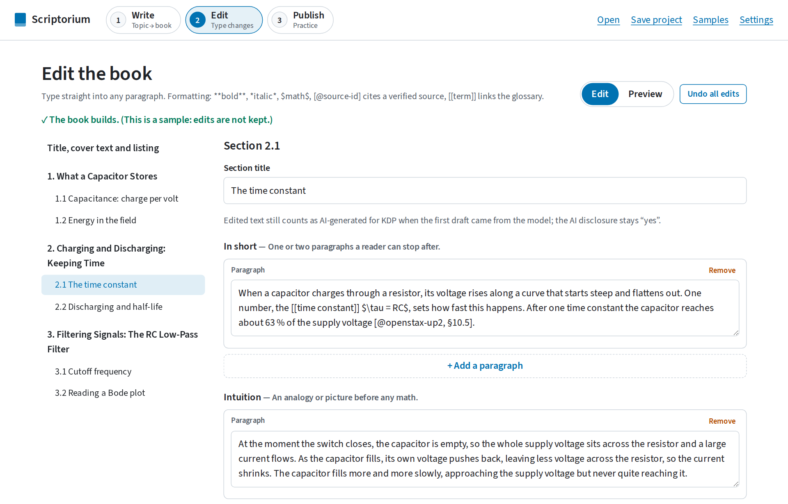
  </picture>
</p>

*Figure 2 — The app has three steps, one button each: Write (type a topic, press Generate), Edit (type into any paragraph; Preview shows the finished book), Publish (build, check and save the KDP package).*

<p align="center">
  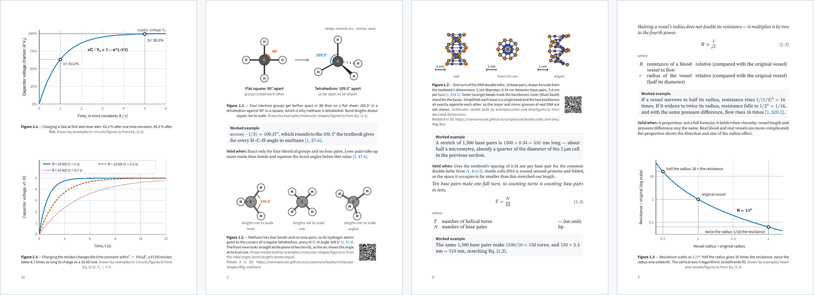
</p>

*Figure 3 — One printed page from each domain's sample book. 3D models print as three fixed views plus a QR code that opens the rotatable version.*

<p align="center">
  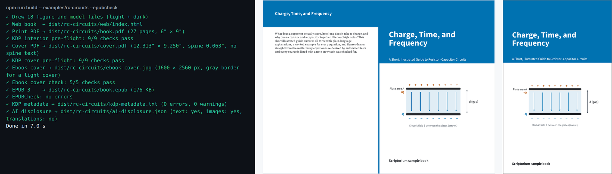
</p>

*Figure 4 — One command builds everything KDP asks for and checks it: interior PDF, full-wrap cover, ebook cover, EPUB 3 and a metadata sheet.*

---

## Quick start

You need **Node.js 20.19 or newer** (22 recommended; `.nvmrc` pins 22). For the optional checks: **Python 3.10+** (equation tests) and **Java 11+** (EPUBCheck). On Windows, use WSL 2 or Git Bash for these commands; `scripts/setup.ps1` does the same setup in PowerShell.

```bash
git clone https://github.com/Normansrule/scriptorium.git
cd scriptorium
npm ci
npm run demo
```

Expected output of `npm run demo` (a few seconds):

```text
✓ Drew 18 figure and model files (light + dark)
✓ Web book  → dist/rc-circuits/web/index.html
✓ Print PDF → dist/rc-circuits/book.pdf (27 pages, 6" × 9")
✓ KDP interior pre-flight: 9/9 checks pass
✓ Cover PDF → dist/rc-circuits/cover.pdf (12.313" × 9.250", spine 0.063", no spine text)
✓ KDP cover pre-flight: 9/9 checks pass
✓ Ebook cover → dist/rc-circuits/ebook-cover.jpg (1600 × 2560 px, gray border for a light cover)
✓ Ebook cover check: 5/5 checks pass
✓ EPUB 3    → dist/rc-circuits/book.epub (176 KB)
✓ KDP metadata → dist/rc-circuits/kdp-metadata.txt (0 errors, 0 warnings)
✓ AI disclosure → dist/rc-circuits/ai-disclosure.json (text: yes, images: yes, translations: no)
Done in 3.2 s
```

Open `dist/rc-circuits/web/index.html` in a browser, `book.pdf` and `cover.pdf` in a PDF viewer, and `book.epub` in an ebook reader.

Build all four sample books, then run the checks:

```bash
npm run build:all -- --allow-short --epubcheck   # one-chapter samples are under KDP's 24-page minimum on purpose
npm test                                         # 121 unit, export, app and pipeline tests
python -m pip install -r requirements.txt
npm run test:equations                           # re-derives every equation in the four sample books
```

Expected: a summary line per book ending `✓ rc-circuits  27 pages  all checks pass`, then `Tests  121 passed (121)` and `34 passed`.

Open the app — in a browser (the same one that runs on GitHub Pages) or as a desktop window:

```bash
npm run app            # browser: open the address it prints, usually http://localhost:5173
npm run desktop        # desktop window (needs Rust and, on Linux, the WebKitGTK packages below)
```

Desktop installers (`.deb`, `.rpm`, `.AppImage`, `.msi`, `.dmg`) are attached to each [GitHub release](https://github.com/Normansrule/scriptorium/releases) with SHA-256 checksums and build-provenance attestations. To build them yourself on Ubuntu:

```bash
curl --proto '=https' --tlsv1.2 -sSf https://sh.rustup.rs | sh -s -- -y && . "$HOME/.cargo/env"
sudo apt-get install -y libwebkit2gtk-4.1-dev libayatana-appindicator3-dev librsvg2-dev patchelf libssl-dev libdbus-1-dev build-essential
npm run desktop:build  # installers land in src-tauri/target/release/bundle/
```

One-step setup instead: `bash scripts/setup.sh` (Linux, macOS, WSL) or `pwsh scripts/setup.ps1` (Windows), or open the folder in a devcontainer (`.devcontainer/`).

---

## How it works

<p align="center">
  <picture>
    <source media="(prefers-color-scheme: dark)" srcset="assets/rendered/pipeline.dark.svg">
    
  </picture>
</p>

*Figure 5 — The nine stages. The two amber stages are human checkpoints: nothing is researched until you approve the outline, and nothing is published until you approve the proof.*

The architecture is one TypeScript core used by three front ends:

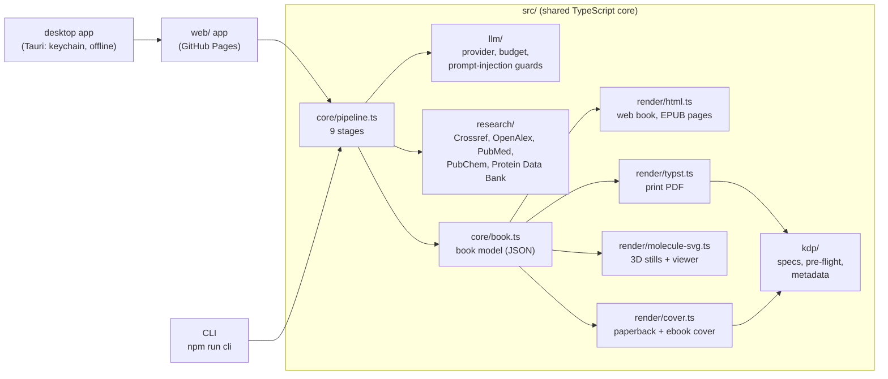

*Figure 6 — Architecture: the web app, the command line and the desktop app share one core, so a book behaves the same everywhere. The desktop app is the web app in a native window (Tauri), plus three Rust commands that store the API key in the operating system's keychain.*

### 1 · Topic + scope

You give a topic, audience, depth, length, domain profile and citation style, plus a **spending cap** in tokens. The run stops *before* any model call that could exceed the cap:

$$ \text{spent} + \text{max\_tokens}(\text{next call}) \le \text{cap} \tag{1} $$

- *spent*: input + output tokens already used by this book, as reported by the provider (tokens)
- *max\_tokens*: the most the next reply may use (tokens)
- *cap*: your limit for this book (tokens)

Worked example: cap 400 000, spent 396 500, the next draft allows 6 000 → 402 500 > 400 000, so the run stops and asks you to raise the cap. Tested in `tests/unit/budget.test.ts`. The cap is in tokens rather than dollars because token counts come back exactly while prices change.

The **domain profile** (`profiles/*.json`) sets the citation style, which databases to search, the figure types, unit conventions, safety text and topics that must stay at textbook level:

| Profile | Citation style | Databases | 3D figures | Extra care |
|---|---|---|---|---|
| Engineering | IEEE | Crossref, OpenAlex | — | Electrical safety notes |
| Chemistry | American Chemical Society (ACS) | Crossref, OpenAlex, PubChem | Molecules | No synthesis routes for hazardous substances |
| Biology | Nature | Crossref, OpenAlex, PubMed, Protein Data Bank | Proteins, DNA | No pathogen methods |
| Medicine | American Medical Association (AMA) | PubMed, Crossref, OpenAlex | — | Educational disclaimer; flagged for licensed-professional review; no dosing |

<picture>
  <source media="(prefers-color-scheme: dark)" srcset="assets/rendered/screens/app-write.dark.png">
  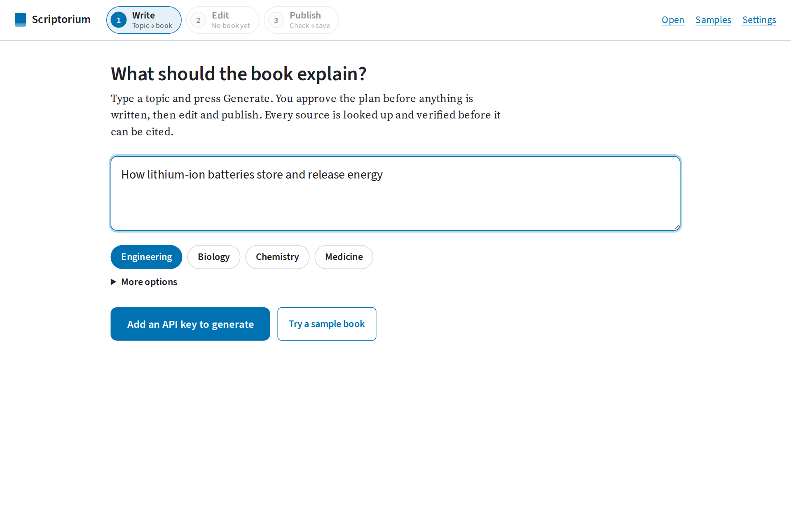
</picture>

*Figure 7 — Stage 1 in the app: a topic, a domain, one button. Audience, depth, length, citation style and the token cap sit under More options.*

### 2 · Outline — checkpoint

The model proposes chapters, sections, learning goals and search queries as JSON. You edit and approve; nothing else happens until you do.

### 3 · Research

Search queries from the outline go to **Crossref** and, depending on the profile, **OpenAlex** and **PubMed** (public scholarly databases). Only whitelisted fields are copied from their replies.

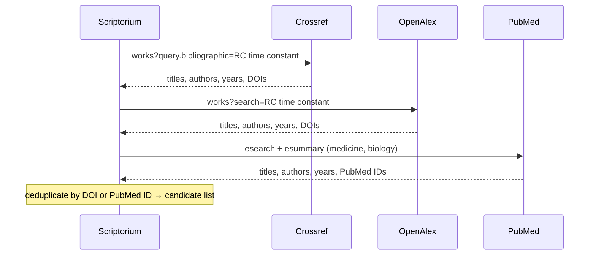

*Figure 8 — Research sends keywords only; no key, drafts or personal data.*

### 4 · Verification

A reference is kept only if its Digital Object Identifier (DOI) resolves in Crossref — or its PubMed ID (PMID) in PubMed — **and** the record matches. The title match uses the Jaccard similarity of the two titles' word sets:

$$ J(A,B) = \frac{\lvert A \cap B \rvert}{\lvert A \cup B \rvert} \ge 0.8 \tag{2} $$

- *A, B*: sets of lower-cased content words in the two titles (small words such as "the" and "of" removed); *J* has no unit and runs from 0 to 1.

Worked example: "A Practical Method of Designing RC Active Filters" vs. Crossref's "A practical method of designing RC active filters" → the same 6 content words → J = 6/6 = 1, and the year (1955) and first author (Sallen) also match, so the reference is verified. A fabricated title on a real DOI scores 0 and is dropped. Tested in `tests/unit/scholarly.test.ts`.

**Limits:** this proves the source *exists and is the one named*. Whether it *supports a claim* is checked in stage 7 against the abstract, and flagged for a human when it can't be confirmed.

### 5 · Drafting

Each section is written in five layers, so a reader can stop after any layer and still have a correct picture:

<picture>
  <source media="(prefers-color-scheme: dark)" srcset="assets/rendered/layers.dark.svg">
  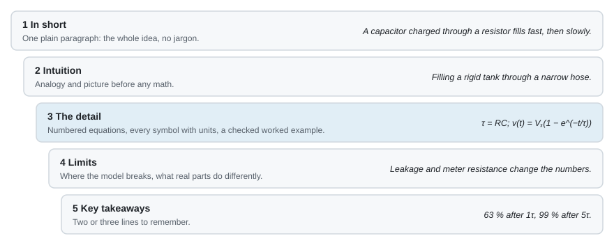
</picture>

*Figure 9 — The five writing layers, with examples from the sample book.*

The model may cite **only** references that passed stage 4, as `[@id]`. A citation guard removes anything else and records it in the verification report, so a model cannot invent a source into the book.

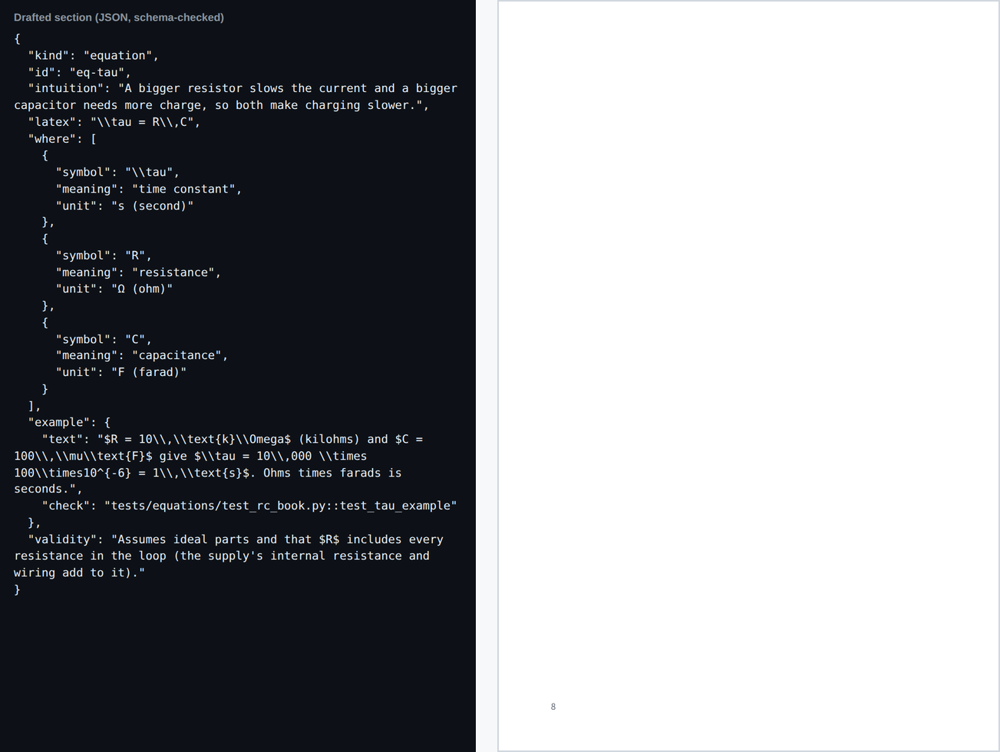

*Figure 10 — Before and after: drafting returns structured data; layout turns it into a finished page.*

### 6 · Figures, equations and 3D models

Technical figures are **drawn by code**, never by an image generator. The model may propose a plot as an expression such as `1 - exp(-x)`; a small parser (`src/core/expr.ts`) evaluates it without `eval`, so a hostile expression can only fail to parse. Every equation must render in KaTeX and convert to Typst, or it is dropped.

<picture>
  <source media="(prefers-color-scheme: dark)" srcset="examples/rc-circuits/figures/tau.dark.svg">
  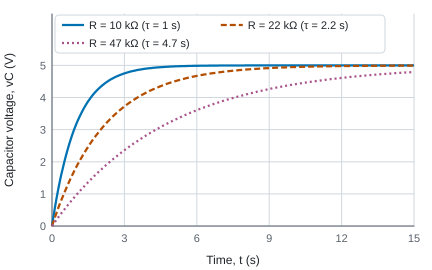
</picture>

*Figure 11 — A code-drawn figure from the engineering sample: what changes when R changes. Drawn by `examples/rc-circuits/figures.ts`.*

**3D structures.** In the chemistry and biology profiles a draft may ask for a molecule from **PubChem** or a protein from the **Protein Data Bank (PDB)**; the coordinates are downloaded, size-limited and parsed by strict file parsers, or a model is built by code from cited dimensions. Each model becomes:

- on the web, a viewer you rotate by dragging or with the arrow keys (nothing moves on its own, so reduced-motion settings need no special case);
- in print and EPUB, three fixed views drawn by the same renderer, with a scale bar (or "not to scale"), angle labels only in views where the angle is shown at true size, and a link — in print also a QR code — to the rotatable version.

<picture>
  <source media="(prefers-color-scheme: dark)" srcset="assets/rendered/screens/app-3d.dark.png">
  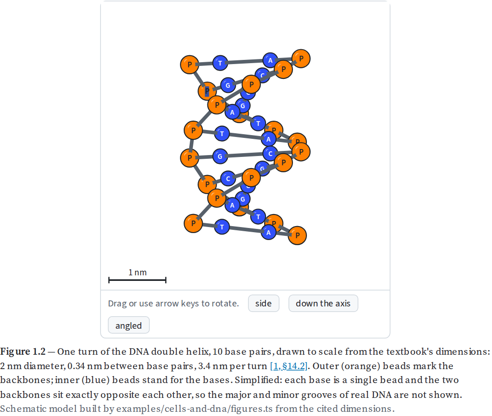
</picture>

*Figure 12 — The DNA model in the biology sample, built to scale from the textbook's dimensions (2 nm across, 0.34 nm per base pair, 10 base pairs per turn). `tests/equations/test_biology.py` re-measures the model file.*

Every equation's worked example in the sample books is re-derived by SymPy (algebra) and Pint (units) in `tests/equations/`; for new books, equations are marked **unverified** in the report until you add such a check.

### 7 · Expert review

A second model call, with a separate "skeptical referee" prompt that never sees the drafting instructions, checks accuracy, the algebra and units of worked examples, missing caveats, restricted detail for the domain, and whether each citation is supported by that source's abstract. Its findings go into the verification report; high-severity ones are marked as problems.

### 8 · Readability

Body text targets reading grade 10–12, measured with the Flesch–Kincaid grade level [9]:

$$ G = 0.39\,\frac{\text{words}}{\text{sentences}} + 11.8\,\frac{\text{syllables}}{\text{words}} - 15.59 \tag{3} $$

- *G*: approximate U.S. school grade (no unit); *words, sentences, syllables*: counts in the text (math, citations and code removed first).

Worked example: "The cat sat on the mat." has 6 words, 1 sentence, 6 syllables → G = 0.39·6 + 11.8·1 − 15.59 = −1.45. Tested in `tests/unit/readability.test.ts`. **Limits:** syllables are counted with a vowel-group heuristic, so the grade is a guide for the readability pass, not a gate. The glossary is built from the `[[terms]]` marked in the text, and a build fails if a marked term has no glossary entry.

### 9 · Layout + export — checkpoint

**Web book.** One static page: KaTeX HTML + MathML, light and dark figures, a Content Security Policy. Books without 3D models run no JavaScript; books with models load one script of our own.

**Print interior.** Typeset by **Typst** through its WebAssembly build, so no separate install is needed. Then:

- the **gutter** (inside margin) is recomputed from the final page count and raised if KDP requires more [2];
- bookmarks, annotations and document metadata are **stripped**, because KDP rejects them in interior files [2];
- **pre-flight** checks page size, page count, gutter, fonts, bookmarks, annotations, metadata, encryption and file size.

**Paperback cover.** One PDF with back, spine and front, sized with KDP's formula [3]:

$$ W_{\text{cover}} = b + w + n\,s_{\text{paper}} + w + b \tag{4} $$

- *b*: bleed, 0.125 in; *w*: trim width (in); *n*: page count, rounded up to even; *s<sub>paper</sub>*: spine thickness per page (in/page), 0.002252 for white paper, 0.0025 for cream.

Worked example: 6″ × 9″, 212 pages, white paper → spine = 212 × 0.002252 = 0.4774 in, cover width = 0.125 + 6 + 0.4774 + 6 + 0.125 = **12.7274 in**; spine text is allowed because 212 > 79 pages. Tested in `tests/unit/kdp.test.ts`. The generator keeps all text and images at least 0.5 in inside the trim (KDP asks for at least 0.125 in for text and 0.25 in from the outside edge [2], [3]), prints spine text only above 79 pages with 0.0625 in clearance [3], and leaves a white 2″ × 1.2″ area at the lower right of the back, at least 0.25 in from spine and trim, where KDP places the barcode [4]. Cover pre-flight re-checks the size, the safe zones, fonts and metadata. `tests/unit/kdp-outputs.test.ts` proves the layout for every KDP trim size and paper.

**Ebook.** An **EPUB 3** file [16]: reflowable XHTML pages, equations as MathML, figures as light-mode SVG, a table of contents and landmarks, accessibility metadata, and a link from each 3D figure to the web edition. Every page is sanitized and re-serialized as XHTML; the archive is reproducible (fixed timestamps, identifier derived from title and authors). `--epubcheck` validates it with the W3C's EPUBCheck [17]. The **ebook cover** is the same front design rendered as a 1600 × 2560 px RGB JPEG — KDP's ideal size — with a thin medium-gray border when much of the edge is white, as KDP suggests for light covers [5].

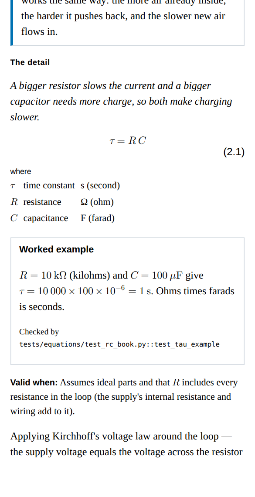

*Figure 13 — The EPUB reflows to a phone screen; equations stay real text (MathML).*

**Publishing from the app.** The app's Publish step builds the same files inside the browser or desktop window — Typst runs as WebAssembly, loaded only the first time you publish — and runs the same pre-flight. A test (`tests/unit/package.test.ts`) builds the engineering sample through this path and checks it matches the command line: 27 pages, every check passing. KDP has no upload API, so the app never uploads anything; it saves one package (`book.pdf`, `cover.pdf`, `book.epub`, `ebook-cover.jpg`, `kdp-metadata.txt`, `ai-disclosure.json`, `preflight.json`, `UPLOAD-CHECKLIST.txt`) for you to upload on kdp.amazon.com. Before the **Save** button unlocks, five guards must pass:

1. **Automated checks:** the book builds (no unknown citations, missing glossary terms or broken equations) and every interior, cover, ebook-cover and listing check passes.
2. **Your confirmations:** you read the proof, checked the references, will match the cover text and answer the AI-content questions as listed — plus licensed-professional review for medicine.
3. **Weekly limit:** KDP allows 2 new titles per format per week [2]. The app keeps a log of the packages it made on this device and blocks a third new title in a format within 7 days, saying when the next slot opens. A new edition of a title you already packaged is an update, not a new title, so it is allowed.
4. **Repeats:** making the exact same package again (same content, trim, paper and format), or the same title twice within a day, needs a deliberate tick. If this device cannot keep the log (for example a private window), the app says so and asks you to count your titles yourself.
5. **Typed title:** the button stays disabled until you type the book's title exactly; after one save it locks until the book, the print settings or the formats change. A build that finishes after the book changed is thrown away, and only one build runs at a time.

The rules are pure functions tested in `tests/unit/publish-guard.test.ts`. Sample books make a clearly labelled practice package that never counts toward the limit.

<picture>
  <source media="(prefers-color-scheme: dark)" srcset="assets/rendered/screens/app-publish.dark.png">
  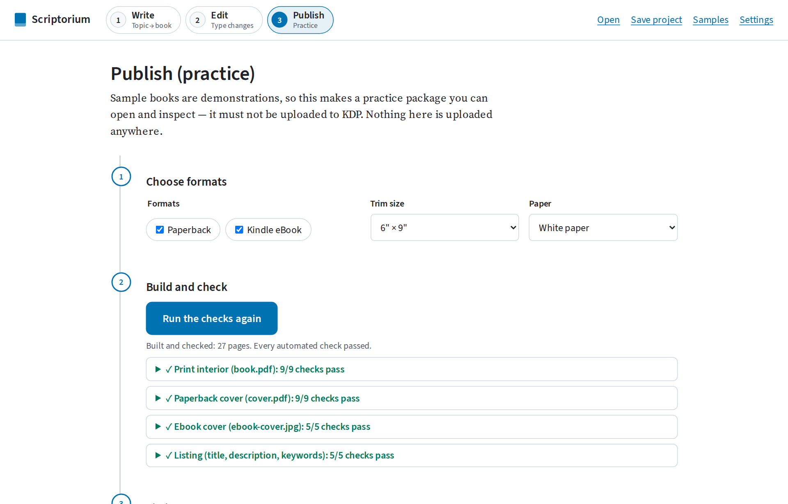
</picture>

*Figure 14 — The Publish step: build and check inside the app; the Save button below stays locked until every guard passes.*

**Metadata helper.** `kdp-metadata.txt` lists the title, subtitle, description, keywords and categories in the order KDP's form asks for them, with checks: title plus subtitle under 200 characters [6], description at most 4000 characters using only the HTML tags KDP supports [8], up to seven keywords without prohibited terms such as "free", "bestselling" or program names [7], [6], up to three categories [6], and a warning when you reach KDP's limit of two new titles per format per week [2].

**AI disclosure.** KDP asks separately whether text, images and translations are AI-generated, and counts content created by an AI tool as AI-generated even after heavy human editing [1]. Every section and figure records its provenance, and each build writes `ai-disclosure.json` with the three answers and the parts that caused them.

---

## Walkthrough

1. **Build the sample.** `npm run demo` → `dist/rc-circuits/book.pdf` opens as a 27-page 6″ × 9″ book, `cover.pdf` as a 12.313″ × 9.25″ wrap-around cover.
2. **Check the pre-flight report.** Open `dist/rc-circuits/preflight.json` → sections `interior`, `cover`, `ebookCover` and `metadata`, every check passing.
3. **Re-derive the math.** `npm run test:equations` → `34 passed`. Change a number in a worked example in `examples/rc-circuits/book.json`, rerun `npm run test:equations`, and see which check names it.
4. **Rotate a molecule.** `npm run build:all -- --allow-short`, open `dist/molecular-shapes/web/index.html`, drag the methane model, then press **front**: the 109.5° label appears only when the angle is face-on.
5. **Re-verify the references.** `npm run verify-refs` → one line per reference; the Sallen–Key paper is re-checked live against Crossref, the three web sources show when they were checked by hand.
6. **Validate the ebook.** `npm run cli -- epubcheck dist/rc-circuits/book.epub` → `✓ EPUBCheck: no errors` (needs Java).
7. **Look at a figure in both themes.** Open `examples/rc-circuits/figures/bode.svg` and `bode.dark.svg`; change `R_OHMS` in `examples/rc-circuits/figures.ts`, run `npm run figures`, and watch the cutoff move.
8. **Write your own book.** Copy `.env.example` to `.env`, add your Anthropic API key, then run
   `npm run generate -- --topic "How lithium-ion batteries store energy" --chapters 3`.
   It pauses at the outline (edit `books/draft-*/outline.json`, press Enter) and before export, then builds the web book, PDF, cover and EPUB and prints how many tokens it used. Read `report.json` before publishing: every item marked `problem` needs a human decision.
9. **Or use the app.** `npm run app` (or `npm run desktop`) → Settings → paste your key → **Write**: type a topic, press Generate, approve the plan → **Edit**: type changes, check Preview → **Publish**: Build and check, tick the confirmations, type the title, Save. Try the whole flow without a key on a sample book (Samples → any book → Publish makes a practice package).

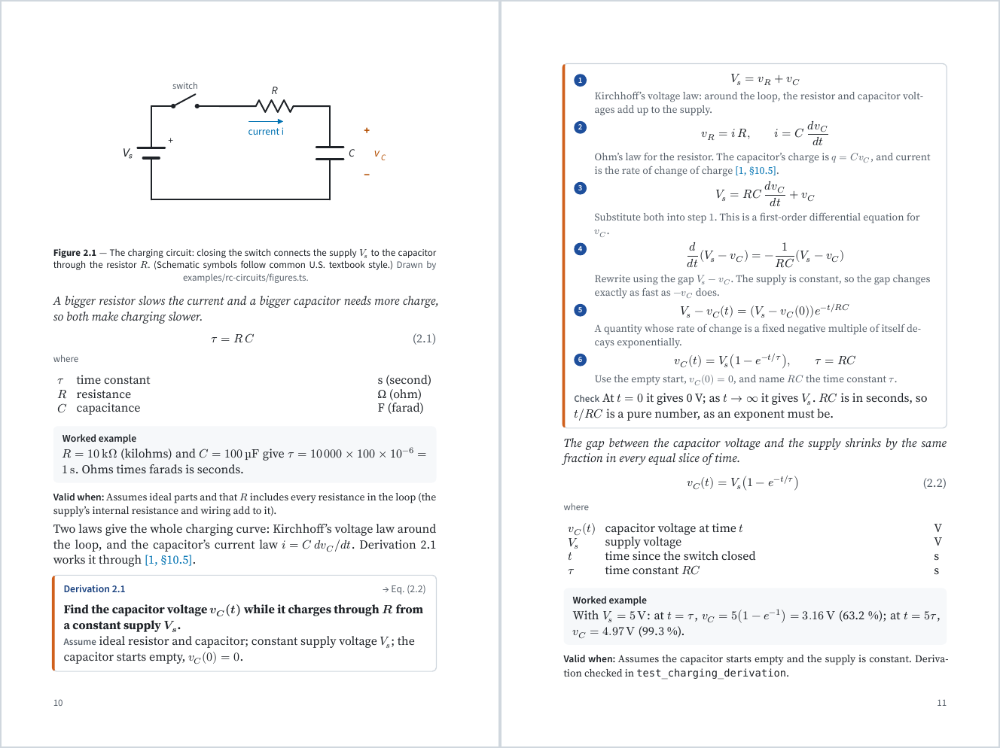

*Figure 15 — A spread from the 6″ × 9″ print PDF. Each equation comes with an intuition sentence, a symbol table with units, a worked example re-checked by a test, and the conditions where it stops being valid.*

---

## Project layout

```text
scriptorium/
├── src/
│   ├── core/          book model (book.ts), pipeline (9 stages), domain-profile schema,
│   │                  style tokens (style.ts), safe plot expressions, readability,
│   │                  3D model parsing (molecule.ts: XYZ, PDB, SDF)
│   ├── llm/           model provider (key handling), spending cap + rate limit,
│   │                  prompts, prompt-injection guards
│   ├── research/      Crossref, OpenAlex, PubMed search and verification;
│   │                  PubChem and Protein Data Bank structure downloads
│   ├── render/        HTML (KaTeX), Typst (print), SVG plots, schematics, CSL citations,
│   │                  3D stills + viewer, QR codes, covers
│   ├── kdp/           KDP numbers with sources (specs.ts), interior + cover pre-flight,
│   │                  metadata helper
│   ├── disclosure/    KDP AI-disclosure checklist
│   ├── export/        PDF, covers, EPUB, the KDP package and publishing guards — shared by
│   │                  the command line and the app (Typst native or WebAssembly)
│   ├── node/          Node-only: load a book folder; native Typst; web export
│   └── cli/           `npm run cli`: build, build-all, generate, build-project,
│                      verify-refs, epubcheck, spine, preflight
├── web/               the app (Vite): Write, Edit and Publish steps, project files, autosave,
│                      bring-your-own key, in-app typesetter loader
├── src-tauri/         desktop shell (Rust, Tauri 2): keychain commands, link and download
│                      handling, least-privilege capability, icons
├── profiles/          one JSON file per domain: engineering, chemistry, biology, medicine
├── styles/            CSL citation styles (IEEE, ACS, AMA, Nature) + en-US locale
├── examples/          one sample book per domain: book.json, references.json,
│   ├── rc-circuits/       figures.ts (draws figures/ and models/)
│   ├── molecular-shapes/
│   ├── cells-and-dna/
│   └── heart-and-vessels/
├── tests/
│   ├── unit/          Vitest: KDP specs and outputs, palette contrast, security,
│   │                  exports, pipeline, profiles, every sample book
│   └── equations/     SymPy + Pint checks for every equation and 3D model in the samples
├── assets/
│   ├── src/           sources for README art (hero, diagrams)
│   └── rendered/      generated SVGs and screenshots (never edit by hand)
├── scripts/           render_assets.ts, screenshots.py, pytest.mjs, setup.sh, setup.ps1
└── docs/              PROJECT_BRIEF, BUILD_PROMPT, STYLE, SECURITY_MODEL, ADDING_A_DOMAIN
```

---

## Security

- **Your API key** lives in the browser tab's memory (or, only if you tick *Remember on this device*, in that browser's local storage); in the desktop app, in the operating system's keychain (Windows Credential Manager, macOS Keychain, or GNOME Keyring / KWallet through the Secret Service); or in your shell environment for the command line. It is sent only to `api.anthropic.com` in a request header. It is never logged, exported, written into a project file, or included in error messages (tested).
- **What leaves your machine:** prompts and drafts go to the model provider; search keywords, DOIs and PubMed IDs go to Crossref, OpenAlex and PubMed; compound names and PDB IDs go to PubChem and the Protein Data Bank. Nothing else. There is no telemetry.

<picture>
  <source media="(prefers-color-scheme: dark)" srcset="assets/rendered/security.dark.svg">
  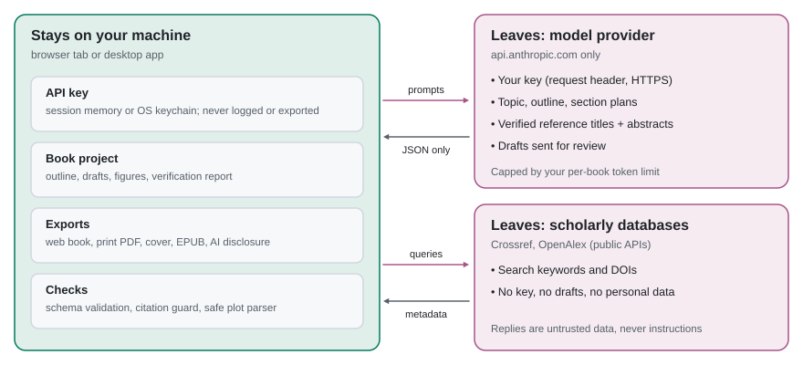
</picture>

*Figure 16 — The security model.*

- **Untrusted content:** abstracts, search results, structure files and model replies are data, never instructions. They are wrapped and cleaned before reaching the model, model output must pass a schema, citations must point at verified sources, plot expressions go through a parser without `eval`, structure files through strict parsers, and every page is escaped and then sanitized with DOMPurify (EPUB pages too).
- **Web pages** ship a strict Content Security Policy: `default-src 'none'` blocks every script in books without 3D models; books with models allow only our own viewer script (`script-src 'self'`). The app allows its own scripts plus WebAssembly (`'wasm-unsafe-eval'`) for the in-app typesetter, never `eval`: the few placeholder functions Typst's WebAssembly glue would build with `new Function` are supplied without eval (`src/export/typst-wasm.ts`).
- **Publishing** is guarded: nothing is uploaded, and saving a KDP package needs passing checks, your confirmations, KDP's weekly title limit, and the typed title (see stage 9).
- **Medicine** books carry an educational disclaimer, never give individual treatment or dosing, and are flagged for review by a licensed professional on every build.
- **Dependencies** are pinned in `package-lock.json` and `requirements.txt`; Dependabot and CodeQL run on the repository; continuous integration (CI) jobs have read-only permissions.

Threat model: [docs/SECURITY_MODEL.md](docs/SECURITY_MODEL.md). Report a vulnerability: [SECURITY.md](SECURITY.md).

---

## Troubleshooting

| Symptom | Cause | Fix |
|---|---|---|
| `process.loadEnvFile is not a function` or `SyntaxError` on start | Node.js older than 20.19 | `nvm install 22 && nvm use 22`, then `npm ci` again |
| `error: externally-managed-environment` from `pip install` | Your system Python is protected (PEP 668) | `python3 -m venv .venv && . .venv/bin/activate`, then `python -m pip install -r requirements.txt` |
| `Typst could not compile the book: … font` | Fonts come from npm packages that were not installed | `npm ci` (not `npm install --omit=dev`), then `npm run demo` |
| `✗ EPUBCheck: Java is not installed` | EPUBCheck is a Java program | Install a Java runtime 11 or newer (for example Eclipse Temurin), or drop `--epubcheck` |
| `KDP interior pre-flight … below KDP's minimum of 24` on a sample | The one-chapter gallery samples are deliberately short | Add `--allow-short` for samples; a real book needs at least 24 pages |
| App says `Model provider returned 401` | Wrong or expired API key | Settings → paste a new key → Save key |
| `… is rate-limiting requests (429)` during research or `verify-refs` | Crossref, OpenAlex or PubMed limits request rates | Set `CROSSREF_MAILTO` in `.env` (Crossref's polite pool) and retry a minute later; PubMed allows about 3 requests per second without a key |
| `Could not reach api.crossref.org` (or another host) | Offline, or a firewall or proxy blocks it | Check the connection; behind a proxy set `HTTPS_PROXY`. Building existing books needs no network |
| Desktop app: `error while loading shared libraries: libwebkit2gtk-4.1.so.0` | The WebKitGTK runtime is missing (Linux) | `sudo apt-get install -y libwebkit2gtk-4.1-0`, or install the `.deb`, which pulls it in |
| Desktop app: *The key is kept for this session only: … system keychain …* | No Secret Service is running (common on WSL and minimal Linux) | `sudo apt-get install -y gnome-keyring`, then start the app from a desktop session; the key still works for the current session |
| `npm run desktop` fails with `cargo: not found` | Rust is not installed | Install it with rustup (see [Quick start](#quick-start)), then open a new terminal |
| App: *Could not build the package: Could not load …* | The first Publish downloads the typesetter (about 30 MB) and the connection dropped | Press **Run the checks again**; after one successful load it works offline |
| App: the Save button stays grey | A guard is not satisfied | Read the list under the button: it names each missing check, confirmation or limit |
| `Stopped before "draft …": it could use up to … tokens` | The spending cap was reached | Raise *Token cap for this book* (app) or `--cap` (command line) |

---

## References and further learning

Citation style: IEEE. All sources are in English.

[1] Amazon Kindle Direct Publishing, "Content Guidelines," section *Artificial intelligence (AI) content*. [Online]. Available: https://kdp.amazon.com/en_US/help/topic/G200672390 (accessed Sep. 30, 2026).

[2] Amazon Kindle Direct Publishing, "Paperback Submission Guidelines." [Online]. Available: https://kdp.amazon.com/en_US/help/topic/G201857950 (accessed Sep. 30, 2026).

[3] Amazon Kindle Direct Publishing, "Create a Paperback Cover." [Online]. Available: https://kdp.amazon.com/en_US/help/topic/G201953020 (accessed Oct. 1, 2026).

[4] Amazon Kindle Direct Publishing, "Barcodes." [Online]. Available: https://kdp.amazon.com/en_US/help/topic/G5HDYGP4BXLX4RUW (accessed Oct. 1, 2026).

[5] Amazon Kindle Direct Publishing, "Cover Image Guidelines" (Kindle eBooks). [Online]. Available: https://kdp.amazon.com/en_US/help/topic/G6GTK3T3NUHKLEFX (accessed Oct. 1, 2026).

[6] Amazon Kindle Direct Publishing, "Metadata Guidelines for Books." [Online]. Available: https://kdp.amazon.com/en_US/help/topic/G201097560 (accessed Oct. 1, 2026).

[7] Amazon Kindle Direct Publishing, "Make Your Book More Discoverable with Keywords." [Online]. Available: https://kdp.amazon.com/en_US/help/topic/G201298500 (accessed Oct. 1, 2026).

[8] Amazon Kindle Direct Publishing, "Write a Book Description." [Online]. Available: https://kdp.amazon.com/en_US/help/topic/G201189630 (accessed Oct. 1, 2026).

[9] J. P. Kincaid, R. P. Fishburne Jr., R. L. Rogers, and B. S. Chissom, "Derivation of new readability formulas (Automated Readability Index, Fog Count and Flesch Reading Ease Formula) for Navy enlisted personnel," Naval Technical Training Command, Millington, TN, USA, Research Branch Report 8-75, Feb. 1975. [Online]. Available: https://stars.library.ucf.edu/istlibrary/56/

[10] World Wide Web Consortium, "Web Content Accessibility Guidelines (WCAG) 2.2," W3C Recommendation. [Online]. Available: https://www.w3.org/TR/WCAG22/

[11] Crossref, "REST API" documentation. [Online]. Available: https://www.crossref.org/documentation/retrieve-metadata/rest-api/

[12] OpenAlex, "Works" API reference. [Online]. Available: https://developers.openalex.org/api-reference/works/get-a-single-work

[13] National Center for Biotechnology Information, "Entrez Programming Utilities Help." [Online]. Available: https://www.ncbi.nlm.nih.gov/books/NBK25501/

[14] National Center for Biotechnology Information, "PUG REST" (PubChem programmatic access). [Online]. Available: https://pubchem.ncbi.nlm.nih.gov/docs/pug-rest

[15] RCSB Protein Data Bank, "File Download Services." [Online]. Available: https://www.rcsb.org/docs/programmatic-access/file-download-services

[16] World Wide Web Consortium, "EPUB 3.3," W3C Recommendation. [Online]. Available: https://www.w3.org/TR/epub-33/

[17] World Wide Web Consortium, "EPUBCheck." [Online]. Available: https://www.w3.org/publishing/epubcheck/

[18] Typst documentation. [Online]. Available: https://typst.app/docs/

[19] Citation Style Language. [Online]. Available: https://citationstyles.org/

Each sample book lists its own sources, with a verification record for each, in its `references.json`: OpenStax *University Physics Volume 2*, MIT OpenCourseWare 6.002, Analog Devices *Basic Linear Design* and Sallen & Key 1955 (engineering); OpenStax *Chemistry 2e*; OpenStax *Biology 2e*; OpenStax *Anatomy and Physiology 2e*.

---

## Roadmap

| Milestone | Scope | Status |
|---|---|---|
| 1 | Engineering profile, 3-chapter sample book, web export + print PDF, interior pre-flight | **Done** |
| 2 | Chemistry, biology and medicine profiles with sample books; PubMed, PubChem and Protein Data Bank; rotatable 3D models with printed stills + QR links | **Done** |
| 3 | EPUB 3 export with EPUBCheck, paperback cover generator, ebook cover, cover pre-flight, metadata helper | **Done** |
| 4 | Tauri desktop app with OS-keychain key storage; release installers with SHA-256 checksums + build-provenance attestations | **Done** |
| 4b | Three-step app (Write, Edit, Publish); print PDF, covers and EPUB built inside the app; publishing guards | **Done** |
| 5 | arXiv search; code-signed installers; web book export from the app | Next |

---

## Contributing, license and credits

Contributions are welcome — see [CONTRIBUTING.md](CONTRIBUTING.md) and [docs/ADDING_A_DOMAIN.md](docs/ADDING_A_DOMAIN.md). Every visual follows [docs/STYLE.md](docs/STYLE.md).

**License.** Code: MIT ([LICENSE](LICENSE)). Sample book text and figures (`examples/`): Creative Commons Attribution 4.0 (CC BY 4.0).

**Credits.**

- Fonts: Source Serif 4 and Source Sans 3 by Adobe, SIL Open Font License 1.1 (installed from npm, embedded in the PDF). Math: KaTeX fonts (MIT); New Computer Modern Math and DejaVu Sans Mono (bundled with Typst).
- Citation styles and locale: Citation Style Language project, CC BY-SA 3.0 (`styles/`).
- Colors: hues from the Okabe–Ito colorblind-safe palette (M. Okabe and K. Ito, *Color Universal Design*, 2008). Atom colors follow the common Corey–Pauling–Koltun (CPK) convention.
- Libraries: Typst and typst.ts (Apache-2.0), KaTeX (MIT), citeproc-js (CPAL-1.0 or AGPL-1.0), DOMPurify (Apache-2.0 or MPL-2.0), jsdom (MIT), pdf-lib (MIT), Zod (MIT), Vite (MIT), esbuild (MIT), qrcode (MIT), resvg-js (MPL-2.0), jpeg-js (BSD-3-Clause), fflate (MIT), EPUBCheck (BSD-3-Clause, via epubcheck-static, ISC).
- Sample-book sources: OpenStax textbooks (Rice University), cited, not copied.
- The sample books and much of this repository were drafted with an AI assistant (Claude, by Anthropic) and checked as described in each book's verification report.
