# Phase 0 gate — Scriptorium: The Living Textbook Forge

Status: **waiting for your pick** (visual concept, flagship topic, and the open questions at the end). Phase 1 does not start until then.

What this phase delivered:

1. An audit of the repo against [the project context](PROJECT_CONTEXT.md).
2. Research, with sources.
3. An architecture for one source → two editions, including the 2D → 3D converter.
4. Three visual concepts with mockups.
5. Beyond the brief, a **working 3D Edition prototype**. It renders the four sample books as 3D books you can turn. Their figures lift off the page, and the book's own 3D models rise and rotate. A transistor scene kit shows the cut-away, explode, X-ray and process timeline. This puts the riskiest part of the plan (does 3D actually work on real pages?) in front of you now rather than in Phase 4.

---

## 1. Audit

| Area | What works today | What's missing for the Living Textbook Forge | Reuse? |
|---|---|---|---|
| Book source | Strict JSON schema (`src/core/book.ts`): five layers per section (summary → intuition → formal → limits → takeaways); every equation must have an intuition, symbol list and worked example; chapter goals and summary; glossary links | Markdown/MDX authoring (today it's JSON); practice problems with solutions; a "common misconceptions" block (the *limits* layer is close); a chapter hook; an index | **Keep the schema** as the canonical model; add an MDX front end that compiles to it |
| Research + citations | Crossref, OpenAlex, PubMed, PubChem and Protein Data Bank (PDB); every reference must resolve before it can be cited; `verify-refs` re-checks DOIs | Standards and agency sources as first-class reference types; per-claim support notes in the UI | Keep |
| Generation pipeline | Topic → outline (review gate) → research → verification → drafting → figures → expert review → readability → layout, each stage visible in the app | Re-running a single stage from the UI; a proofing pass as its own stage | Keep; add stage re-run |
| Figures | Code-drawn SVG with a colour-blind-safe role palette; molecules/DNA from cited coordinates with print stills and QR links | A shared figure spec for 2D and 3D (designed below); cutaways and exploded views; real-data charts with dataset citations | Extend |
| 2D Edition (print) | Typst (WebAssembly in the app); gutter recomputed from page count; KDP clean-up; interior and cover pre-flight; full-wrap cover; 1600 × 2560 ebook cover | Baseline grid, margin notes, running heads; contrast check in pre-flight; a cover *designer* UI (the generator exists) | Keep Typst; extend the template |
| EPUB 3 | Sanitized XHTML, MathML, reproducible archive, EPUBCheck clean | Nothing blocking | Keep |
| App | Three steps (Write, Edit, Publish), in-app KDP package with five publishing guards, web edition export, autosave | React (today it's vanilla TypeScript; see open questions); 3D Edition build inside the app | Keep; add the 3D step |
| Desktop | Tauri 2 with OS-keychain key storage, signed-provenance installers for Linux, Windows and macOS, WSL graphics fix | Code signing | Keep |
| Quality | 132 tests (unit, export, app, pipeline), equation re-derivation in Python, EPUBCheck, CodeQL, Dependabot | Golden-file PDF/EPUB tests (pixel diffs were run by hand this phase), visual regression, performance budgets | Add in Phase 2 |
| **3D Edition** | **New this phase:** pages, figure positions, viewer, page turns, pop-off figures, transistor kit, converter v0 (see §5) | glTF assets with level of detail (LOD), living-diagram kits per subject, turntable stills back into print, imported PDF/EPUB conversion | Build on the prototype |

## 2. Research

**KDP print and ebook rules.** The repo already implements, with citations, KDP's paperback submission rules [1]: trim sizes, bleed, the inside margin by page count (raised automatically from the final page count), no bookmarks, annotations or metadata in the interior, and embedded fonts. It also implements the cover formula and barcode area [2], [3], the ebook cover size (ideal 1600 × 2560 px) [4], and the metadata rules [5]. Those were read from KDP's own help pages on Sep. 30 – Oct. 1, 2026. The context asks for a re-check against live documentation before each release, and I couldn't open KDP's pages from this session. That re-check is still to do, so it's listed in the Phase 6 checklist. Recent secondary write-ups ([a], [b]) agree with the margin table the code uses.

**AI-content disclosure.** KDP asks whether text, images or translations are *AI-generated*; AI-*assisted* editing need not be declared [6]. Write-ups from 2026 describe the same split ([c], [d]). Scriptorium already writes `ai-disclosure.json` with the answers. The 3D Edition carries the same answers in its About panel.

**Best-designed textbooks and explainers: what to take, what to avoid.**

| Reference | Why it works | What it misses (our opening) |
|---|---|---|
| OpenStax [7], [e] | Open licence (CC BY), consistent figure style, accessibility work (alt text, MathML) | Static figures; layout is utilitarian; no figure can be explored |
| Bartosz Ciechanowski's explainers [f], [g] | Every figure is an interactive model you scrub and rotate; prose and model are inseparable | Hand-built per article (no pipeline); no print edition; no citations apparatus |
| Kurzgesagt-style visuals | One visual language, strong colour, motion that explains a process | Video only; no references in the material itself; no rigour layer |
| 3D flipbooks [h], [i] | Real page turns sell the "book" feeling | Pages are dead images: nothing comes off the page, no figure semantics |

**Our synthesis.** OpenStax's rigour and openness, Ciechanowski's explorable figures and real page turns, generated by one pipeline from one cited source, with the print book never compromised.

**Paged.js vs Typst for print.** Typst wins for us. It is already in the codebase (Node and WebAssembly), it is fast enough to re-typeset on every edit, it does real math and page-level control, and it gave us the figure-position anchors the 3D Edition needs (§3). Paged.js renders CSS paged media in a browser. It's attractive for HTML-first authoring, but needs a headless browser for PDF output, has weaker math and fine-typography control, and struggles with float placement in long books [j], [k], [l]. Recommendation: **stay on Typst**, and borrow Paged.js-style CSS only for the web edition's print stylesheet.

## 3. Architecture

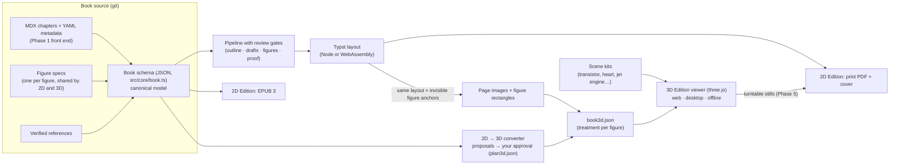

**Book source.** The JSON schema stays canonical because the validators, citation guard, renderers and tests all speak it. Phase 1 adds MDX + YAML as an authoring front end that compiles into it (round-trip tested), so authors can write in git-friendly text.

**One figure spec for both editions.** Every figure keeps its id, alt text, caption, credit, provenance and print form (an SVG, or stills of a model). The 3D Edition adds a **treatment** (`src/edition3d/manifest.ts`):

| Treatment | What it does in 3D | Needs approval? |
|---|---|---|
| `flat` | Stays on the page | — |
| `lift` | Rises off the page as a card you can tilt and bring close | No |
| `model` | The book's own 3D data (atoms and bonds from cited coordinates) | No |
| `scene` | A scene kit: named parts you can cut away, explode, X-ray and animate | **Yes** |

**How the converter decides** (`src/edition3d/convert.ts`). Figures with 3D data become models. Otherwise it scores each scene kit against the figure's own words (alt text and caption): keyword matches add confidence, a veto word (for example *schematic symbol*) rules the kit out, and below a threshold nothing is proposed. A scene replaces your figure with generic geometry, so the rule prefers a miss (the figure still lifts) over a wrong scene. Proposals and your decisions live in `plan3d.json` next to the book. A decision survives re-planning only while the proposal it answered still stands. Phase 5 adds an optional AI pass that suggests kits with a reason, still behind your approval.

**Where figures are on the page.** The print layout already knows: when building the 3D Edition, the Typst source gets invisible `metadata` anchors at the top and bottom of each figure, queried after compilation. The build refuses to continue if the page count differs from the print interior, and a pixel comparison of all 27 pages of the engineering sample showed the print PDF unchanged by the anchors.

**Web and desktop share the engine.** `src/edition3d/build.ts` is written against the same `TypstEngine` interface as the KDP exporter: Node (resvg + JPEG) on the command line, WebAssembly + canvas in the app. The viewer is a separate, CSP-locked page (`web/3d.html`) bundled into the Pages site and, in Phase 7, into the desktop app for offline reading.

## 4. Three visual concepts

These were dealt with taste-skill's direction library from the one-line brief, then run through Impeccable's craft floor and emil-design-eng's motion rules (one authored motion moment, strong ease-out, no animation on keyboard-repeated actions, reduced motion falls back to the 2D Edition). All three keep the 2D Edition's typography (Source Serif 4 / Source Sans 3) and the colour-blind-safe figure palette, because those are already proven in print.

### A. Bookcloth — *recommended*

The book is the object. A cobalt bookcloth ground, bone-white paper, and **one accent: the madder-orange headband thread**, which also marks every figure you can lift. Display type: a sturdy grotesk (mockups use Schibsted Grotesk, OFL). App: the open book sits centre stage; Write / Edit / Publish hang as ribbon bookmarks. The signature moment: a figure rises off its page while the camera leans in.

| 2D spread | 3D, figure popped | Website hero |
|---|---|---|
| 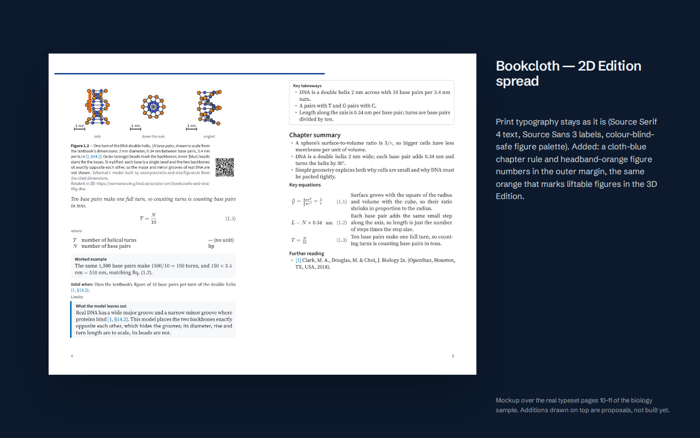 | 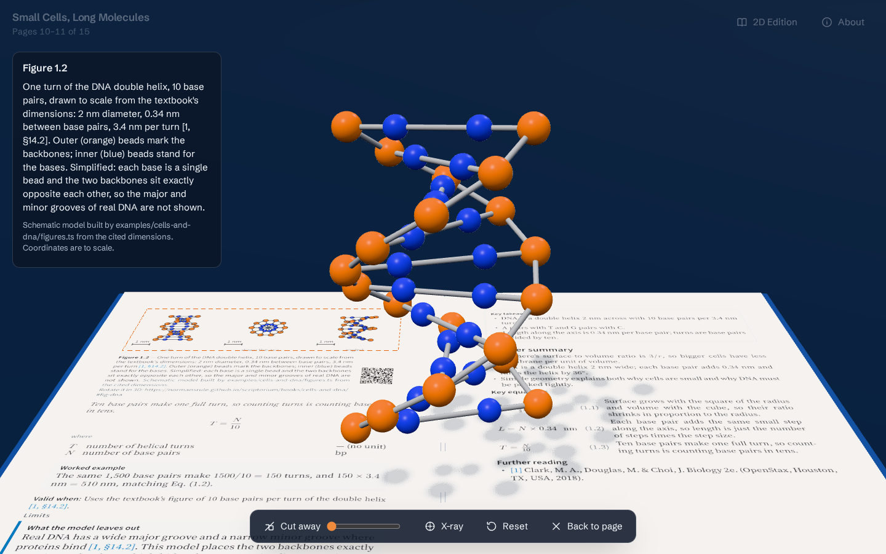 | 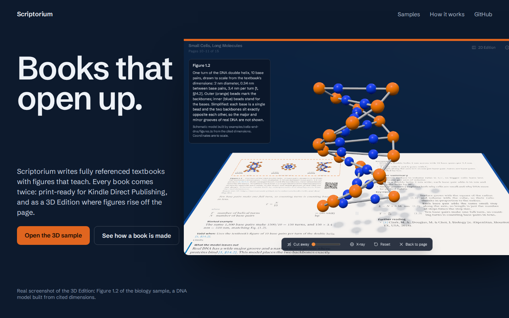 |

### B. Plate & Field

A printed annual crossed with encyclopedia plates. White paper, black ink, whole fields of vermilion, sage and acid yellow. Figures become numbered plates with lettered callouts that turn into 3D labels. Neo-grotesk throughout (mockups use Geist, OFL). Exact, authoritative, cool.

| 2D spread | 3D, figure popped | Website hero |
|---|---|---|
| 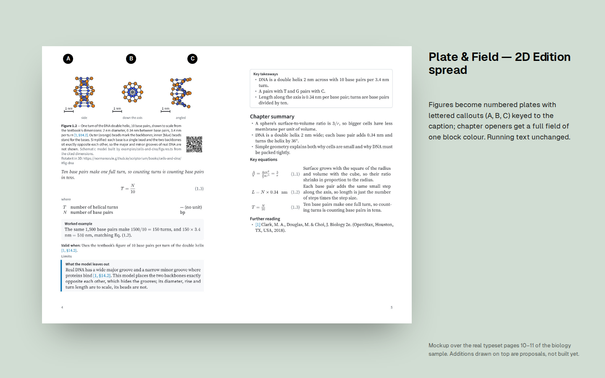 | 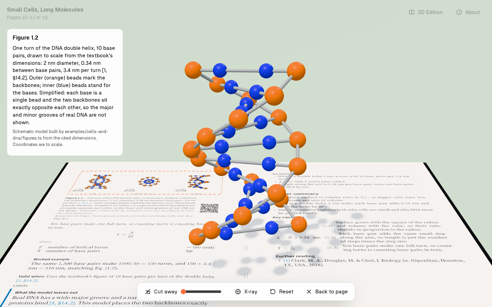 | 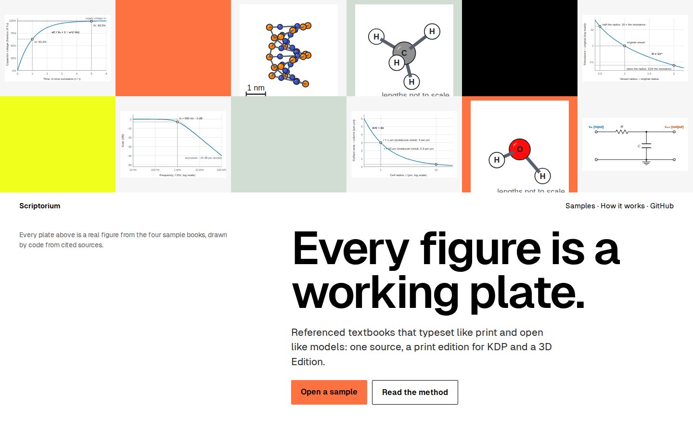 |

### C. Sentence & Window

Each screen is one short sentence with a live window in it: "Every figure can [live model] step off the page." Tobacco, olive and ochre; Hanken Grotesk (OFL). Warm and editorial; the 3D figure is seen through a window into the page.

| 2D spread | 3D, figure popped | Website hero |
|---|---|---|
| 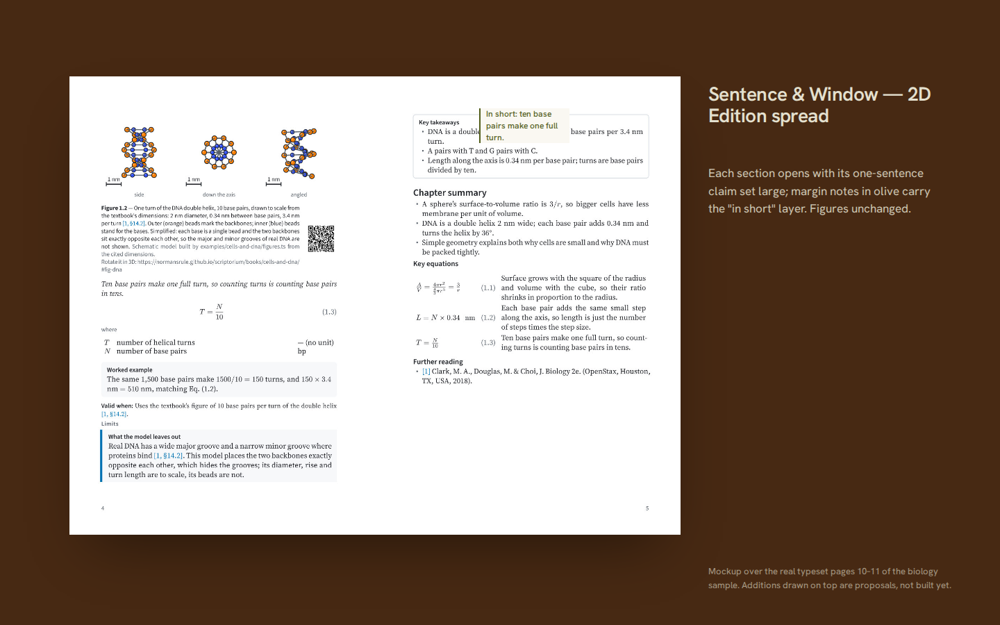 | 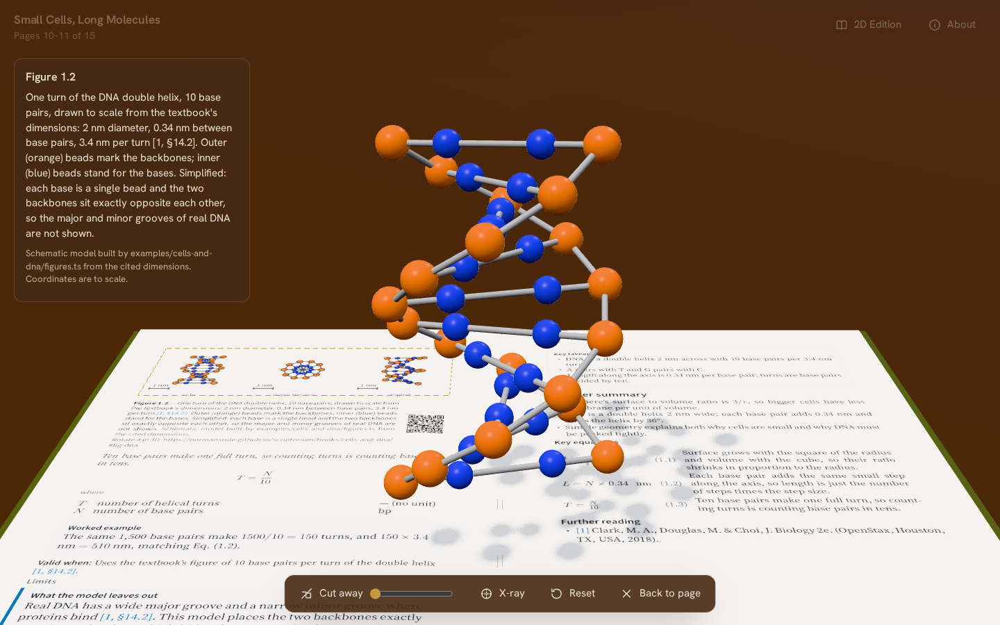 | 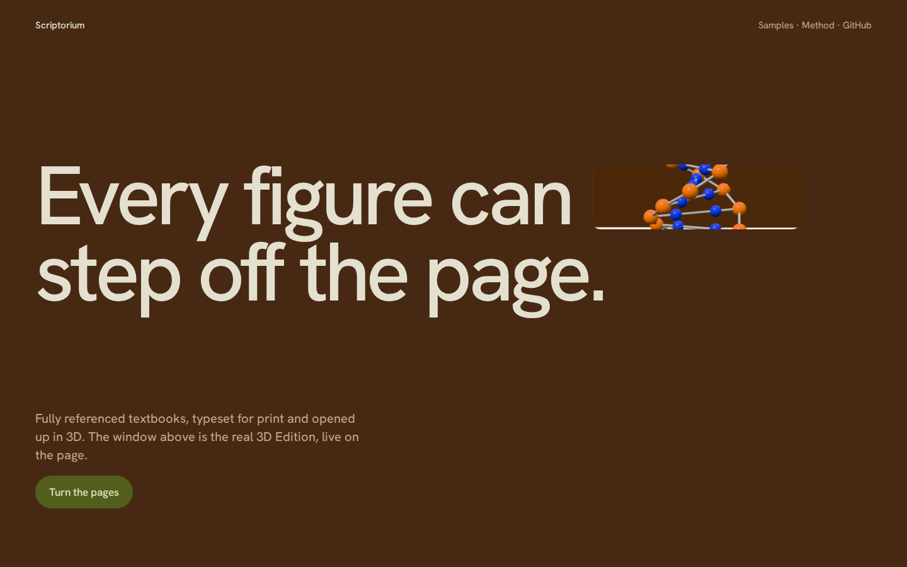 |

Mockups of the 2D spread draw their additions over the real typeset pages; the 3D pictures are real screenshots of the prototype in each theme (`3d.html?theme=bookcloth|plate|window`).

## 5. The 3D Edition prototype

- `npm run cli -- plan3d examples/<book>` lists each figure, the converter's proposal and why. `--approve fig-x` / `--reject fig-x` record your decisions.
- `npm run cli -- edition3d examples/<book>` writes `dist/<book>/edition3d/` (page images, figure images, models, `book3d.json`).
- Viewer: `3d.html?book=books/<book>/3d/`, or `3d.html?kit=mosfet` for the transistor kit.
  - Turning pages: ← → or a drag/flick.
  - Figures: Tab to a figure and press Enter to lift it. Drag or use the arrow keys to rotate. X toggles X-ray, L labels, Space plays the timeline, R resets, Esc puts it back.
  - Reduced motion offers the 2D Edition first; if you open 3D anyway, nothing animates.
  - Sound: none.

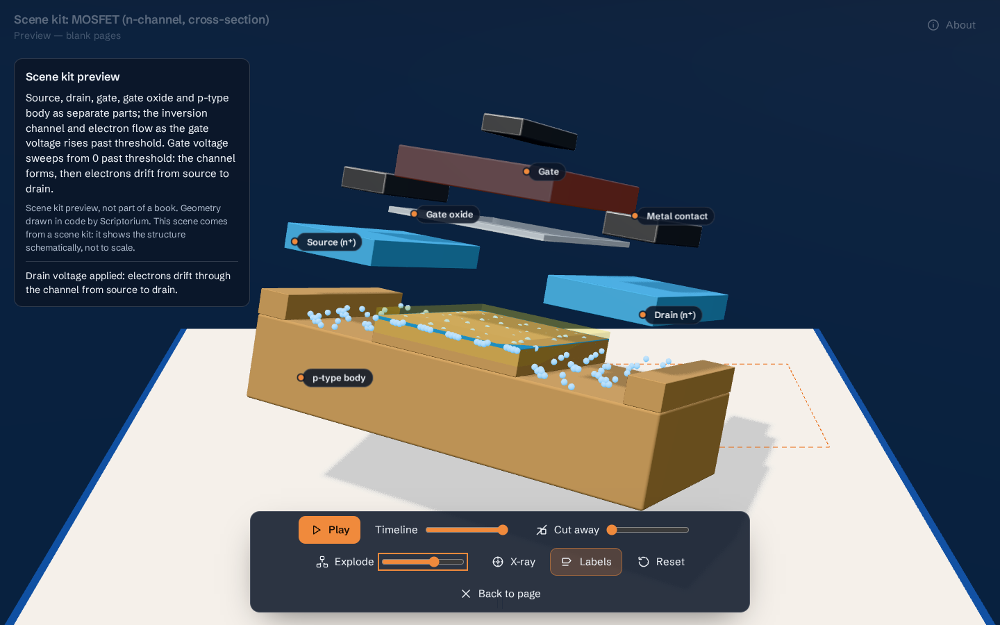

Measured so far: the spread renders at interactive rates in a software renderer (SwiftShader). Frames are drawn only while something moves. The viewer bundle is 585 kB (151 kB gzipped). Performance on a mid-range laptop and a phone is a Phase 4 measurement; the frame budget can't be proven from here.

## Open questions

1. **Concept:** A (Bookcloth, recommended), B or C — or a mix (e.g. A's world with B's lettered plates)?
2. **Flagship chapter (Phase 3):** I recommend **the transistor** (MOSFET: structure, threshold, channel formation, switching). Every figure benefits from 3D (cross-section, cutaway, exploded layers, an animated channel), the kit already exists, and it fits the engineering profile. The heart is the most dramatic, but convincing anatomy needs licensed or commissioned models. A jet engine needs many bladed parts. Pick one.
3. **React:** the context suggests React + React Three Fiber. Today's app is small vanilla TypeScript and the viewer is plain three.js, which keeps the bundle and CSP simple. Keep vanilla (my recommendation), or move the app to React in Phase 1?
4. **Fonts:** the dealt directions named General Sans and Switzer (ITF Free Font License). Their redistribution terms in an open-source repo need checking. The mockups use OFL faces with similar character instead. OK to stay OFL-only?
5. **Imported PDFs/EPUBs** for the converter: confirm this is for books you have the rights to, and whether text extraction (no layout) is acceptable for imports.

## Sources

[1] Amazon KDP, "Paperback Submission Guidelines," https://kdp.amazon.com/en_US/help/topic/G201857950 (accessed Sep. 30, 2026).
[2] Amazon KDP, "Create a Paperback Cover," https://kdp.amazon.com/en_US/help/topic/G201953020 (accessed Oct. 1, 2026).
[3] Amazon KDP, "Barcodes," https://kdp.amazon.com/en_US/help/topic/G5HDYGP4BXLX4RUW (accessed Oct. 1, 2026).
[4] Amazon KDP, "Cover Image Guidelines" (Kindle eBooks), https://kdp.amazon.com/en_US/help/topic/G6GTK3T3NUHKLEFX (accessed Oct. 1, 2026).
[5] Amazon KDP, "Metadata Guidelines for Books," https://kdp.amazon.com/en_US/help/topic/G201097560 (accessed Oct. 1, 2026).
[6] Amazon KDP, "Content Guidelines — Artificial intelligence (AI) content," https://kdp.amazon.com/en_US/help/topic/G200672390 (accessed Sep. 30, 2026).
[7] OpenStax, "Accessibility at OpenStax," https://openstax.org/accessibility-hub

Secondary (search results, Oct. 25, 2026; not used for any rule in the code):
[a] Ceeryo, "KDP book margins and gutter: the 2026 spec, explained," https://www.ceeryo.com/blog/kdp-book-margins-and-gutter-guide ·
[b] SmartKDP, "KDP Margins and Gutter, by Page Count," https://smartkdp.com/guides/kdp-margins ·
[c] publishing.co.uk, "KDP AI-Generated Content Disclosure," https://publishing.co.uk/guides/kdp-ai-content-disclosure/ ·
[d] BookWriter, "Assisted vs Generated," https://www.bookwriter.vip/ai-assisted-vs-ai-generated ·
[e] OpenStax help, "Licensing information," https://help.openstax.org/s/article/Licensing-information-of-OpenStax-textbooks ·
[f] Hacker News discussion of "Mechanical Watch," https://news.ycombinator.com/item?id=31261533 ·
[g] R. Orban, notes on "Mechanical Watch," https://ryanorban.com/notes/mechanical-watch-ciechanowski/ ·
[h] zjy365, "threejs-page-flip," https://github.com/zjy365/threejs-page-flip ·
[i] reatcas, "openflip," https://github.com/reatcas/openflip ·
[j] speedata, "I benchmarked 6 PDF engines," https://news.speedata.de/2026/02/10/typesetting-benchmark/ ·
[k] pistack, "WeasyPrint vs wkhtmltopdf vs Typst vs Paged.js (2026)," https://www.pistack.xyz/posts/2026-06-25-self-hosted-pdf-document-generation-weasyprint-wkhtmltopdf-typst-pagedjs/ ·
[l] Typst documentation, "PDF," https://typst.app/docs/reference/pdf/
